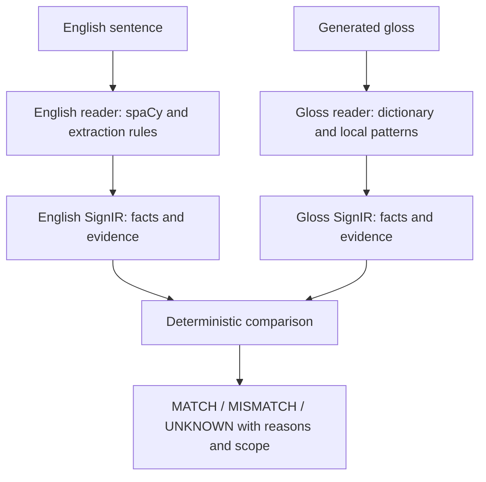

# SignIR-Check

**Inspect selected meaning differences between English sentences and generated ASL gloss.**

SignIR-Check is a Python research prototype by Sanchit and Vedant. It follows our earlier English-to-ASL gloss generation study: sign overlap can look good even when a translation changes a number, an action, or negation. This project extracts selected facts independently from each side, compares them, and shows the evidence behind each result.

It checks people/things, action, negation, attached numbers, and supported roles. Each check returns **MATCH**, **MISMATCH**, or **UNKNOWN**, with supporting text and a reason. Numbers stay connected to their units or nouns; negation stays connected to its action.

The tool checks existing translations. It does not generate ASL, assess signing videos, or establish ASL grammar and naturalness. A MATCH applies only to the stated fact and scope.

## Current status

Version **0.2.0** includes a small English language model and an independent dictionary/rule-based gloss reader. The default checker runs on CPU without a GPU, API key, or translation service. The optional DGX Spark experiment below uses CUDA.

On 643 saved natural pairs, the current version assesses at least one fact in **177 pairs**, while **466 pairs remain entirely UNKNOWN**. Natural role checks remain unsupported. These are coverage measurements, not accuracy: the data was used during repair and has no independent checker-specific ASL gold labels. See [results and methods](reports/natural-repair-2026-10-10/README.md).

The code, authored fixtures, tests, and aggregate reports are included here. Restricted corpus text, saved natural translations, and sentence-level derived results stay outside the public repository.

## Run the DGX Spark experiment

**[Start here: DGX Spark setup and run guide](docs/DGX_SPARK_RUN_GUIDE.md).**
It covers the code checkout, machine requirements, first CUDA test, scored
52-pair challenge, natural-data pilot, resume and result files to collect.

## Quick start

An optional [DGX Spark extraction experiment](experiments/dgx-spark/README.md)
compares the CPU checker, independent CUDA model extraction, and direct model
judgment. It includes a CUDA-only Docker launcher, frozen inputs/prompts/model
revisions, cached raw outputs, blind annotation sheets, and a separate authored
CPU replay smoke test. No GPU experiment results are claimed by this package.

For command interfaces, evidence conventions, and reproducibility details, see the
[technical guide](docs/technical-guide.md).

Use Python **3.11 or newer**. This release was exercised locally with Python 3.14. Create an isolated environment:

```sh
git clone https://github.com/sanaro99/signir.git
cd signir
python -m venv .venv
```

Activate it on Windows PowerShell:

```powershell
.\.venv\Scripts\Activate.ps1
```

Or on macOS/Linux:

```sh
source .venv/bin/activate
```

If activation is unavailable, use `.venv\Scripts\python.exe` on Windows or `.venv/bin/python` on macOS/Linux in place of `python` below.

Install the natural readers and pinned English model:

```sh
python -m pip install -e ".[natural]"
python -m pip install https://github.com/explosion/spacy-models/releases/download/en_core_web_sm-3.8.0/en_core_web_sm-3.8.0-py3-none-any.whl
python -m signir demo
```

The natural extra installs spaCy 3.8.16 and LemmInflect 0.2.3; the English model is en_core_web_sm 3.8.0. Installing only `python -m pip install -e .` supports restricted authored fixtures. Natural inputs require the extra and model. Missing dependencies produce a setup error rather than silently returning UNKNOWN.

## Check a sentence

This is an **authored demonstration**, not a verified natural ASL translation:

```sh
python -m signir check --english "Alice buys 3 apples." --gloss "fs-ALICE BUY 9 APPLE"
```

The attached-number check returns MISMATCH: English says 3 apples and gloss says 9 APPLE. Entity and action checks match; roles and gloss polarity remain UNKNOWN without the required explicit evidence.

Add `--json` to inspect both extracted SignIR records, evidence offsets, values, and check scopes. The installed `signir` command is equivalent to `python -m signir`.

## Process a file

Use UTF-8 JSONL with one pair per line:

```json
{"id":"example-001","english":"Alice buys 3 apples.","gloss":"fs-ALICE BUY 9 APPLE","source_group":"authored-document-001","provenance":{"kind":"synthetic","version":"authored-v1"}}
```

Run the included demo file:

```sh
python -m signir check-file signir/fixtures/demo.jsonl --out results/demo-checks
```

Outputs include `records.jsonl` with both interpretations and evidence, `checks.csv` with statuses, and a manifest with input/code/dependency fingerprints. See [the full input format](docs/input-format.md). For restricted natural data, put input and outputs under ignored `private/`.

## Architecture



English and gloss extraction are independent. The gloss reader receives no English facts, so it cannot fill missing gloss information from the source. Restricted fixtures use the original explicit grammar; broader inputs use the natural fallback.

SignIR schema **1.0** records five fact fields, KNOWN/UNKNOWN states, unchanged source text, and zero-based half-open character evidence spans. Natural extraction adds optional observations, warnings, and scopes. The comparator is deterministic for given records; extraction can still be wrong.

| Component | Responsibility |
|---|---|
| `signir/data.py` | Load/validate pairs, import one saved run, group duplicates and related variants before splitting |
| `signir/english.py`, `signir/gloss.py` | Restricted fixture readers and dispatch to natural extraction |
| `signir/natural.py` | English dependency analysis, independent gloss dictionary lookups, number/polarity patterns |
| `signir/schema.py` | Versioned fact records and evidence validation |
| `signir/compare.py` | Fixed comparison rules with evidence and scope |
| `signir/controlled.py` | Authored examples with deliberately changed facts |
| `signir/evaluate.py`, `signir/baselines.py` | Coverage, controlled detections, overlap baselines, frozen experiment integrity |
| `signir/correction.py` | One saved correction attempt and checks for improvements/regressions |
| `signir/cli.py` | Command-line workflows and JSON/CSV outputs |

Read the [architecture overview](docs/architecture-overview.md) and [SignIR schema](docs/signir-schema.md).

## Reproduce the controlled workflow

Run in order with fresh output names:

```sh
python -m signir build-controlled --out results/controlled.jsonl
python -m signir prepare results/controlled.jsonl --out results/prepared.jsonl
python -m signir freeze results/prepared.jsonl --out results/freeze-v1.json
python -m signir evaluate results/prepared.jsonl --freeze results/freeze-v1.json --out results/evaluation-v1
python -m signir correct signir/fixtures/correction-inputs.jsonl --responses signir/fixtures/corrections.json --out results/correction-v1
python -m unittest discover -s tests -v
```

There are 64 authored fixtures in eight source families, split into 32 development and 32 test examples. They exercise the supported grammar and workflow; they do not establish natural-ASL generalization. Correction replays saved fixture responses, not a live translator.

Freeze records dataset/split/code hashes, thresholds, runtime versions, and extraction dependency/model fingerprints. Evaluation rejects changed inputs or configuration. Historical freezes are evidence for the version that produced them; create a new freeze for the current checkout. Local hashes do not constitute external preregistration.

Evaluation writes summaries, controlled-error tables, extraction/recoverability tables, overlap baselines, and detailed records. Sign F1 and word F1 require reference gloss and compare candidate to reference; they are separate from English-to-gloss checking. See [evaluation methods](docs/evaluation.md) and [correction protocol](docs/correction.md).

## Natural-data audit

The earlier saved corpus is not distributed here. Researchers with authorized local access can use `import-prior` with predictions, corpus, and run manifest paths; see [data inventory](docs/data-inventory.md) and [input format](docs/input-format.md).

Once imported to `private/selected-run.jsonl`:

```sh
python scripts/audit_natural_repair.py private/selected-run.jsonl --out private/natural-audit
```

This assesses originals and makes logged controlled copies of already recoverable numeric/polarity facts. Those selected edits are not a held-out accuracy study. All text-bearing outputs stay private.

## Limitations

- Gloss dictionary categories are lexical hypotheses, not an ASL grammar parser. Homographs, unfamiliar labels, multiple events, and incomplete evidence often cause UNKNOWN.
- Natural entity MATCH compares observed lexical mentions only. Differing inventories abstain; synonymy and complete entity interpretation remain unresolved.
- Natural gloss roles are not inferred from word order. Explicit `AGENT:`/`PATIENT:` labels belong to synthetic fixtures.
- Positive gloss polarity is not inferred from missing NOT. `POS:ACTION` is artificial diagnostic metadata, not standard ASL notation.
- Coreference, general event alignment, classifiers, spatial loci, directional verbs, and nonmanual scope are not broadly supported.
- Natural accuracy and translation grammaticality remain unvalidated; independent qualified annotation is still needed.

## License

The repository uses [GPL-3.0](LICENSE), preserving the license selected for the GitHub repository. Third-party notices, including the recovered MIT-licensed Sign F1 code, are in [THIRD_PARTY.md](THIRD_PARTY.md). Dataset access and redistribution terms are separate from the code license.
