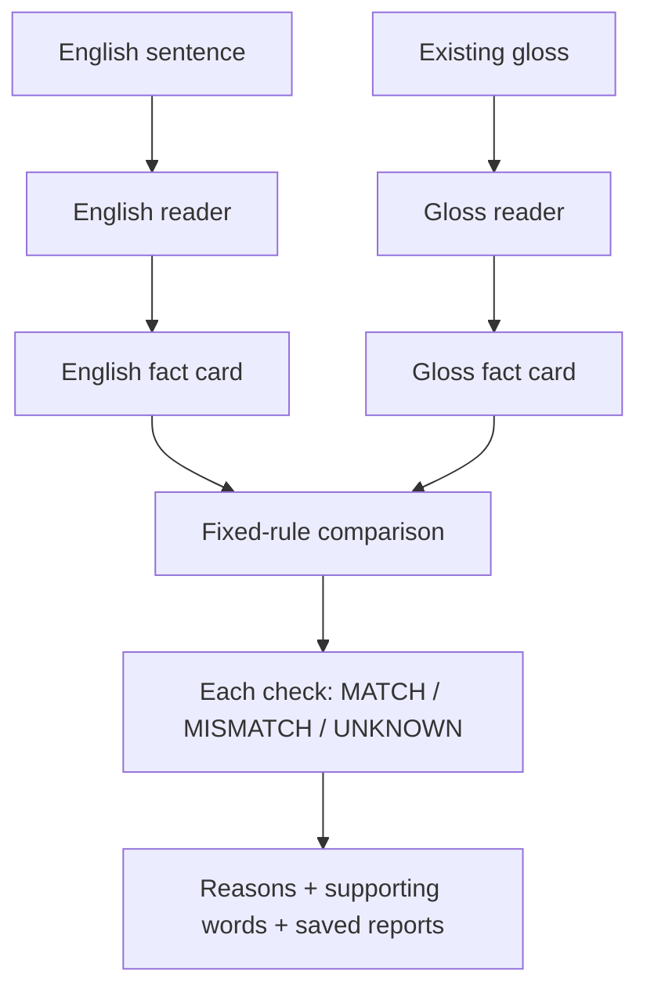

# SignIR-Check: what we built

**A small fact-checking research tool for translations.** Give it an English
sentence and an existing ASL gloss. It looks for selected facts in each, then
reports what agrees, what conflicts, and what it cannot tell.

## The main path

The readers work independently: **the gloss reader cannot borrow facts from the
English sentence**. Both use the same fact-card format, called **SignIR**.

Each card records people/things, the action, negation, numbers and what they
count, and supported “who did what to whom” relationships. Facts keep their
supporting words and positions. Missing evidence stays unknown.

## The individual pieces

| Piece | Its job | Implementation |
| --- | --- | --- |
| Data preparation | Loads saved pairs, keeps their origin and document IDs, and keeps duplicates together when splitting practice/test data. | `data.py` |
| English reader | Uses the restricted fixture grammar or the small spaCy English model and extraction rules. | `english.py`, `natural.py` |
| Gloss reader | Uses fixture grammar or independent dictionary lookups and local patterns; receives no English facts. | `gloss.py`, `natural.py` |
| Shared fact card | Gives both readers the same structured format, including evidence and unknown values. | `schema.py` |
| Comparator | Applies fixed rules to the two cards and explains each result. | `compare.py` |
| Test-example builder | Creates labelled artificial examples with deliberate changes, such as changing a number. | `controlled.py` |
| Evaluation | Measures detections and unknowns, compares against Sign F1/word overlap, and freezes data/rules for repeatable runs. | `evaluate.py`, `baselines.py` |
| Optional correction experiment | Tries one saved example correction, checks it again, and records improvements and regressions. | `correction.py` |
| Command-line entry point | Lets you run these pieces on one pair or a file; saves detailed JSON and CSV summaries. | `cli.py` |

## A concrete example

**English:** “Alice buys 3 apples.”  
**Gloss:** `fs-ALICE BUY 9 APPLE`

The number check reports **MISMATCH**: the English says **3 apples**, while the
gloss says **9 APPLE**. People/things and action match. Roles and gloss polarity
remain **UNKNOWN** because the required explicit evidence is missing.

## Where it stands

**Built:** the complete command-line workflow, evidence records, evaluation,
and a saved correction demonstration. Version 0.2 uses spaCy on English and
LemmInflect dictionary/local rules on gloss. Both run on CPU. No live translation
service is called; we reused one saved generation run.

**Still limited:** it detects the 20 deliberately introduced errors in the
controlled test examples. Version 0.2 assesses at least one fact in 177 of 643
natural-output pairs; 466 remain entirely UNKNOWN. This is coverage, not natural
accuracy. Broader, validated readers are the next research step. Natural ASL roles and
grammar are not established by these tests; role checks currently depend on
explicit artificial test annotations. Correction uses saved examples, not a
live translator. A MATCH is never a certificate of good ASL.

[Run it](../README.md) · [Detailed results](study-report.md)
